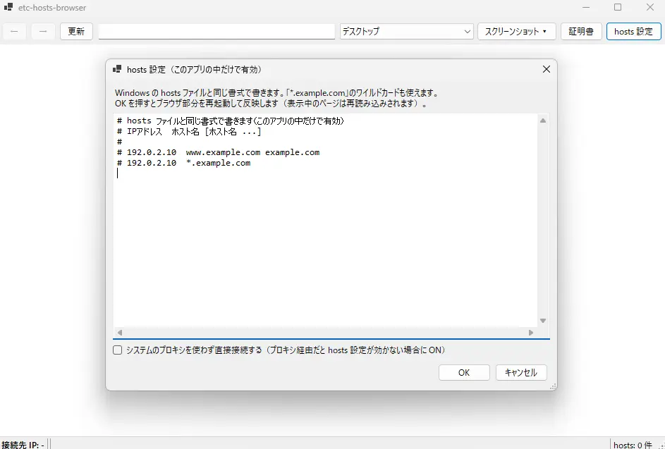

# etc-hosts-browser

Windows の `hosts` ファイルを編集できない（管理者権限がない）環境でも、**hosts を設定したのと同じように Web サイトを確認できる**検証用ブラウザです。

公開前のサーバや切り替え前の新サーバを、本番と同じホスト名のまま確認する用途を想定しています。



## できること

- **アプリ内 hosts**: `hosts` ファイルと同じ書式でホスト名と IP アドレスの対応を設定（このアプリの中だけで有効、管理者権限不要）
- **接続先 IP の常時表示**: 今見ているページがどの IP アドレスに繋がっているかをステータスバーに表示
- **SSL サーバ証明書の表示**: 検証結果、証明書チェーン、有効期限、SAN などを表示
- **証明書が不正でも閲覧可能**: 自己署名やホスト名不一致でもページを表示し、エラー内容をステータスバーに表示
- **レスポンシブ表示確認**: スマートフォン・タブレットの画面幅と User-Agent を模擬
- **スクリーンショット**: 表示範囲またはページ全体を PNG で保存
- **HTTP のまま確認**: `https://` への自動切り替えと HSTS を止めて、`http://` のサイトをそのまま表示
- **CORS の検証**: 応答ヘッダーを上書きして「このヘッダーを返したらどうなるか」を試す／CORS そのものを無効にする
- **Basic 認証**、**フォーム送信**、**ファイルアップロード**に対応
- **AI・スクリプトからの操作**: コマンドラインで条件を指定して JSON で結果を受け取る／DevTools Protocol で外部ツールから操作する

## 動作環境

- Windows 10 / 11（64 ビット）
- [Microsoft Edge WebView2 Runtime](https://developer.microsoft.com/microsoft-edge/webview2/)（Windows 11 には標準搭載。Windows 10 でも多くの場合インストール済み）
- ランタイム同梱版の exe を使う場合、.NET のインストールは不要

インストールも実行も管理者権限は不要です。

## 使い方

`EtcHostsBrowser.exe` を起動します。

1. **hosts 設定** ボタンを押し、`hosts` ファイルと同じ書式で入力して OK
   ```
   192.0.2.10  www.example.com example.com
   192.0.2.10  *.example.com
   ```
2. アドレスバーに URL を入力して Enter
3. ステータスバー左端の **接続先 IP** で、意図したサーバに繋がっているか確認（hosts 設定が効いていれば `[hosts 適用]` と表示）

| 操作 | 内容 |
|---|---|
| デバイス選択 | デスクトップ / iPhone / Android / iPad の表示幅と User-Agent に切り替え |
| スクリーンショット | 「表示されている範囲」または「ページ全体」を PNG で保存 |
| 証明書 | 表示中の HTTPS サイトのサーバ証明書を表示 |
| hosts 設定 | アプリ内 hosts と、下記の各設定の編集。OK でブラウザ部分を再起動して反映 |
| F5 / Ctrl+L | 再読み込み / アドレスバーへ移動 |

### hosts 設定画面のその他の設定

画面下部のチェックボックスで切り替えます。いずれも既定は OFF で、ON の間はステータスバー右端に表示されます。

| 設定 | 内容 |
|---|---|
| システムのプロキシを使わず直接接続する | プロキシ経由だと hosts 設定が効かない場合に ON にする |
| プロトコルを省略した URL を http で開く | 下記「HTTP のまま確認する」を参照 |
| CORS（同一オリジンポリシー）を無効にする | ページの JS が、他のオリジンの応答を制限なく読めるようになる |

### HTTP のまま確認する

既定では、プロトコルを省略した URL は `https://` で開きます。また `http://` と明示しても、ブラウザエンジンが先に `https://` を試し、繋がればそちらを表示します。

「プロトコルを省略した URL を http で開く」を ON にすると、次のようになります。

- プロトコルを省略した URL を `http://` で開く
- `http://` の URL を `https://` に自動で切り替えない
- サイトが HSTS で指定した「次回から https で」を無視する（そのために、ON の間はキャッシュを随時消去します）

次の場合は ON でも `https://` に切り替わります。

- ブラウザエンジンに組み込まれた HSTS プリロードリストに載っているドメイン
- サーバ自身が `https://` へのリダイレクトを返す場合

### 応答ヘッダーの上書き

hosts 設定画面の「応答ヘッダーの上書き」タブに、1 行 1 件で書きます。サーバ側の設定を変える前に「このヘッダーを返したらどうなるか」を試せます。

```
# URLパターン  ヘッダー名: 値     （追加・上書き）
# URLパターン  -ヘッダー名        （削除）
https://api.example.com/*  Access-Control-Allow-Origin: https://www.example.com
https://api.example.com/*  Access-Control-Allow-Credentials: true
https://www.example.com/*  -Content-Security-Policy
```

- URL パターンは URL 全体と照合し、`*` が任意の文字列に一致します（`*` だけならすべての応答）
- 同じ名前のヘッダーが元の応答にあれば、指定した値で置き換えます
- CORS のプリフライト（`OPTIONS`）への応答も対象です
- 変えられるのはヘッダーだけです。サーバが `OPTIONS` にエラーを返す場合は通らないので、「CORS を無効にする」を使ってください

### Cookie などの扱い

Cookie・キャッシュ・サイトのストレージは**ウィンドウを開いている間だけ有効**で、終了すると消えます。毎回まっさらな状態から始まります。

- hosts 設定を反映しても Cookie（ログイン状態）は引き継がれます
- hosts 設定画面の内容とデバイスの選択は保存され、次回起動時も有効です（保存先: `%LOCALAPPDATA%\EtcHostsBrowser`）
- 強制終了した場合、残ったデータは次回の起動時に削除されます

## コマンドライン

```
EtcHostsBrowser.exe [URL] [オプション]
```

| オプション | 内容 |
|---|---|
| `--hosts "IP HOST [HOST...]"` | この起動の間だけ有効な hosts 設定。`;` 区切りで複数指定可、繰り返し指定可 |
| `--hosts-file PATH` | hosts 形式のファイルから読み込む |
| `--device NAME` | `desktop` / `"iPhone SE"` / `"iPhone 15"` / `"iPhone 15 Pro Max"` / `"Pixel 8"` / `"Galaxy S23"` / `iPad` |
| `--viewport WxH` | 表示領域のサイズ（CSS ピクセル。例: `1280x800`） |
| `--basic-auth USER:PASS` | Basic 認証に自動で応答する |
| `--no-proxy` | システムのプロキシを使わず直接接続する |
| `--prefer-http` | プロトコルを省略した URL を `http://` で開き、`https://` に自動で切り替えない |
| `--disable-cors` | CORS（同一オリジンポリシー）を無効にする |
| `--response-header "URLパターン 名前: 値"` | 応答ヘッダーを上書きする。繰り返し指定可。`"URLパターン -名前"` で削除 |
| `--response-headers-file PATH` | 応答ヘッダーの上書き設定をファイルから読み込む（1 行 1 件） |
| `--remote-debugging-port N` | `127.0.0.1:N` で Chrome DevTools Protocol を公開する |
| `--json` | ページを開いて結果を JSON で標準出力に出し、終了する |
| `--screenshot PATH` | PNG スクリーンショットを保存して終了する |
| `--full-page` | スクリーンショットをページ全体にする |
| `--output PATH` | JSON を標準出力ではなくファイルに書く |
| `--wait MS` | 読み込み完了後の待ち時間（既定 1000） |
| `--timeout MS` | 読み込み待ちの上限（既定 30000） |
| `--help` | ヘルプ（英語）を表示 |

`--device` `--viewport` `--basic-auth` 以外の動作オプション（`--hosts` から `--screenshot` まで）をどれか付けて起動すると、**一時セッション**になります。

- 設定画面やデバイス選択で変更した内容を保存しません（保存済みの設定は書き換わりません）
- `--hosts` / `--hosts-file` を指定すると、保存済みの hosts の代わりにそれを使います。指定しなければ保存済みの hosts を使います
- 保存済みの「CORS を無効にする」と応答ヘッダーの上書きは適用しません。コマンドラインで指定した分だけが有効です
- 保存済みの「プロキシを使わない」「http で開く」は、そのまま適用されます

### ワンショットモード（`--json` / `--screenshot`）

ページを開き、結果を JSON で出力して終了します。ウィンドウは画面外に出るので作業の邪魔になりません。

```
EtcHostsBrowser.exe https://www.example.com/ --hosts "192.0.2.10 www.example.com" --device "iPhone 15" --screenshot shot.png --full-page --json
```

```json
{
  "success": true,
  "error": null,
  "httpStatus": 200,
  "requestedUrl": "https://www.example.com/",
  "url": "https://www.example.com/",
  "title": "Example",
  "remoteAddress": "192.0.2.10",
  "remotePort": 443,
  "hostsApplied": true,
  "hostsRules": ["192.0.2.10 www.example.com"],
  "device": "iPhone 15",
  "userAgent": "Mozilla/5.0 (iPhone; ...",
  "viewport": { "width": 393, "height": 852, "devicePixelRatio": 1.5 },
  "tls": {
    "protocol": "TLS 1.3",
    "certificateError": "CertificateCommonNameIsIncorrect",
    "certificate": {
      "connectedTo": "192.0.2.10:443",
      "trusted": false,
      "validationErrors": ["RemoteCertificateNameMismatch"],
      "chain": [
        {
          "subject": "CN=other.example.net",
          "issuer": "CN=Example CA",
          "notBefore": "2026-01-01T00:00:00Z",
          "notAfter": "2027-01-01T00:00:00Z",
          "daysRemaining": 50,
          "subjectAltNames": ["other.example.net"]
        }
      ]
    }
  },
  "screenshot": "C:\\work\\shot.png"
}
```

| 終了コード | 意味 |
|---|---|
| 0 | ページを読み込めた |
| 1 | 読み込み失敗、またはタイムアウト |
| 2 | 引数の誤り |

- 証明書エラーがあってもページは読み込み、`tls.certificateError` と `tls.certificate` に内容を出します（`success` は読み込みの成否で、証明書の正否ではありません）
- JSON 内の日本語は `\uXXXX` 形式で出力されるため、パイプ越しでも文字化けしません

### 外部ツールからの操作（`--remote-debugging-port`）

```
EtcHostsBrowser.exe https://www.example.com/ --hosts "192.0.2.10 www.example.com" --remote-debugging-port 9222
```

`http://127.0.0.1:9222` に Chrome DevTools Protocol（CDP）で接続すると、クリック・入力・DOM の取得などを外部から行えます。hosts 設定と証明書エラーの無視は、外部から操作している間も有効です。CDP 接続に対応したツール（Playwright の `connectOverCDP`、Puppeteer の `connect`、ブラウザ操作用の MCP サーバーなど）から利用できます。

ポートを開けている間は、同じ PC 上の他のプログラムからもこのブラウザを操作できます。必要なときだけ指定してください。

## 注意事項

- **検証専用です。** SSL サーバ証明書のエラーを無視して表示するため、通常のブラウザが防いでくれる盗聴・なりすましを防げません。普段使いのブラウザとしては使わないでください。
- **「CORS を無効にする」は同一オリジンポリシーそのものを外します。** 開いたページのスクリプトが、他のサイトの内容を読み取れるようになります。信頼できるページの検証にだけ使い、終わったら OFF に戻してください。
- **プロキシ環境では hosts 設定が効かないことがあります。** その場合は hosts 設定画面の「システムのプロキシを使わず直接接続する」（または `--no-proxy`）を試してください。
- **`http://` で開いても `https://` に切り替わることがあります。** HTTP のまま確認したいときは「[HTTP のまま確認する](#http-のまま確認する)」の設定（または `--prefer-http`）を使ってください。
- **`--basic-auth` のパスワードはコマンドライン履歴に残ります。** 検証用の認証情報にとどめてください。
- デバイスの模擬は表示幅・User-Agent・タッチ操作の再現であり、実機のブラウザエンジン（Safari など）の挙動までは再現しません。

## Tips

Chromeブラウザを利用している場合、あなたの欲しい機能は既にChromeブラウザに搭載されている可能性があります。「--host-resolver-rules」を調べてみてください。

## ビルド

[.NET 10 SDK](https://dotnet.microsoft.com/download) が必要です。

```
dotnet build -c Release
```

ランタイム同梱の単一 exe（配布用）を作る場合:

```
dotnet publish -p:PublishProfile=win-x64
```

`publish\win-x64\` に `EtcHostsBrowser.exe` とライセンス文書が出力されます。配布する際はフォルダごと渡してください。

## ライセンス

[MIT License](LICENSE)

配布物（ビルド済みの exe）には Microsoft Edge WebView2 SDK（BSD 3-Clause 形式）と、ランタイム同梱版では .NET ランタイムが含まれます。詳細は [THIRD-PARTY-NOTICES.md](THIRD-PARTY-NOTICES.md) を参照してください。ブラウザエンジン本体（WebView2 Runtime）は同梱しておらず、利用者の Windows にインストールされているものを使います。
